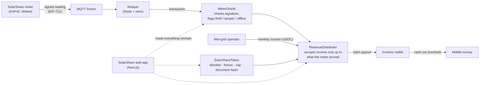

# SolarShare

[](https://github.com/ORANKIIEY/SolarShare/actions/workflows/ci.yml)

**Co-own a community solar mini-grid. Get paid monthly. Guarded by a meter that can't lie.**

Node Engine Hackathon 2026 · Real-World Assets track · Base Sepolia testnet

> 🚧 **Work in progress.** This repository is being built for the hackathon. The table under [Status](#status) shows what works today and what is still being built. Every mock is labelled.

---

## The problem

For neighbours in a South African township who want to co-own a rooftop solar system, getting a fair share of the electricity income is hard. Nobody can easily check how much power was really produced and paid for, and illegal connections quietly drain the income before it reaches the owners.

**We demonstrate stablecoin payouts that only release when a tamper-checked meter has signed for that energy onchain, using shares in a 10 kWp community solar mini-grid.**

## What SolarShare does, in plain English

SolarShare lets ordinary people buy small shares (from about R100) in a community solar mini-grid. The mini-grid sells electricity to nearby homes and spaza shops. Every month, that income is paid to shareholders in a digital dollar (USDC), which they can cash out to mobile money.

The hard part is trust. How do you know the solar system is really working, and that the money isn't being lost to theft? SolarShare answers this with a **SolarShare meter**. It counts every unit of electricity produced and billed, signs each reading with its own secret key, and records it on a public blockchain where anyone can check it. If power is stolen, the meter is tampered with or it goes silent, **payouts pause automatically** and everyone can see why.

**The money, in one page:** where each month's income goes, what investors earn, what theft costs and how SolarShare earns: [`docs/money-model/`](docs/money-model/README.md).

---

## How it meets the track requirements

| Track requirement                                  | SolarShare feature                                                                                             | Status      |
| -------------------------------------------------- | -------------------------------------------------------------------------------------------------------------- | ----------- |
| A token for one specific asset on a public testnet | `SolarShareToken`: 3,500 shares in one mini-grid, on Base Sepolia                                              | 🔨 Building |
| At least one rule enforced onchain                 | Only approved (KYC'd) wallets can hold shares; freeze and recover; supply can never pass the cap               | 🔨 Building |
| Evidence of backing judges can check               | Meter readings signed by the device and verified by the contract; asset documents hashed onchain               | 🔨 Building |
| A path back to cash                                | Monthly payout in test USDC, then cash-out to mobile money (mocked partner)                                    | 🔨 Building |
| Our extra: theft protection                        | If billed energy falls well below produced energy, or the meter is tampered with or goes silent, payouts pause | 🔨 Building |

---

## How it works



1. **The meter measures** the energy produced and the energy billed to customers.
2. **The meter signs** each reading with its own key, the real time and a counter, so readings can't be faked or replayed.
3. **The reading is sent** over MQTT to a relayer, which pays the transaction fee but cannot change the reading.
4. **The contract checks it.** The signature must match our meter, the counter must go up, and the values must be physically possible. It then records the reading and flags theft, tampering or silence.
5. **Money follows the proof.** The operator can only deposit income up to what the meter proved was sold. Shareholders claim their share, unless the meter is in a red state.

### Rules the contracts enforce

| Rule                                                                | When broken                          |
| ------------------------------------------------------------------- | ------------------------------------ |
| Only approved wallets can hold shares                               | Transfer reverts                     |
| Frozen wallets can't move shares; admin can recover to a new wallet | Transfer reverts; recovery is logged |
| Total shares can never exceed 3,500                                 | Mint reverts                         |
| Readings must be signed by the registered meter                     | Reading rejected                     |
| Each reading must be newer than the last                            | Replay rejected                      |
| Power can't exceed the system's 10 kW rating                        | Reading rejected                     |
| Billed energy must stay close to produced energy                    | Status "Theft", payouts paused       |
| No reading for 10 minutes                                           | Status "Offline", payouts paused     |
| Deposited income can't exceed what the meter proved                 | Deposit reverts                      |

Every mint, transfer, freeze, reading and payout emits an event that an auditor can replay.

---

## The demo: the judge plays the thief

1. Buy shares on a phone in under 2 minutes, with no wallet pop-ups or crypto jargon.
2. Open the asset page. The meter is green, readings are arriving, and each one links to Basescan.
3. The operator deposits the month's income and the investor claims a payout.
4. **Hand a judge the Wokwi meter and ask them to steal power.** Within seconds, the app turns red, a signed theft record appears on Basescan, and payouts are paused.
5. Tamper with one number in a reading before it reaches the chain. The contract rejects it.
6. The judge undoes the theft and payouts resume.

---

## What is real and what is mocked

In a one-week hackathon we build the onchain, meter and app layers for real, and mock the physical, legal and banking layers.

| Part                              | In this demo                                               | What it needs to be real                                           |
| --------------------------------- | ---------------------------------------------------------- | ------------------------------------------------------------------ |
| The solar mini-grid               | **Mocked:** simulated meter in Wokwi, illustrative numbers | A solar installer and mini-grid operator                           |
| Legal owner (SPV)                 | **Mocked:** a sample SPV certificate, hashed onchain       | An SPV set up with a law firm; FSCA advice on crypto-asset rules   |
| Identity checks (KYC)             | **Mocked:** an operator "approve" button                   | A KYC provider, e.g. Smile ID                                      |
| Customers paying for power        | **Mocked:** the operator deposits test USDC                | A prepaid electricity vendor using SA's STS prepaid token standard |
| Cash-out to mobile money          | **Mocked:** a receipt screen                               | An on/off-ramp partner, e.g. Kotani Pay or Yellow Card             |
| Meter's secret key                | **Mocked:** stored in firmware (testnet only)              | A secure element chip in the real meter, e.g. ATECC608             |
| Token, rules, signatures, payouts | **Real**, on Base Sepolia                                  | —                                                                  |

---

## Status

| Part                                         | Folder                    | Status      |
| -------------------------------------------- | ------------------------- | ----------- |
| Smart contracts (token, oracle, distributor) | `Blockchain/`             | ✅ Deployed |
| Meter firmware that signs readings           | `Hardware/esp32-edge/`    | 🔨 Building |
| Relayer (MQTT → Base Sepolia)                | `Blockchain/relayer/`     | ✅ Live     |
| Investor and operator web pages              | `Frontend/src/app/solar/` | 🔨 Building |
| Dashboard and design system                  | `Frontend/`               | ✅ Existing |

### Deployed contracts (Base Sepolia)

Chain id **84532** (Base Sepolia, a public test network: test money only). Click an address to see the contract and its source code on Basescan.

| Contract           | Address                                                                                                                         |
| ------------------ | ------------------------------------------------------------------------------------------------------------------------------- |
| SolarShareToken    | [`0x025A0eA625e462A4906C9811dcde14075cBD8491`](https://sepolia.basescan.org/address/0x025A0eA625e462A4906C9811dcde14075cBD8491) |
| MeterOracle        | [`0x3e2e7f87610d978b922f5bD18624101d30D7c8B6`](https://sepolia.basescan.org/address/0x3e2e7f87610d978b922f5bD18624101d30D7c8B6) |
| RevenueDistributor | [`0x3CB94fb9C7AaF42c959A414da750dE2DE761942b`](https://sepolia.basescan.org/address/0x3CB94fb9C7AaF42c959A414da750dE2DE761942b) |
| ShareSale          | [`0x652d15FEb0e57730b78A997c8decd46c81bf5cD2`](https://sepolia.basescan.org/address/0x652d15FEb0e57730b78A997c8decd46c81bf5cD2) |
| USDC (Circle test) | [`0x036CbD53842c5426634e7929541eC2318f3dCF7e`](https://sepolia.basescan.org/address/0x036CbD53842c5426634e7929541eC2318f3dCF7e) |

The full record (addresses, settings, transactions and ABIs) is in [`Blockchain/deployments/baseSepolia.json`](Blockchain/deployments/baseSepolia.json).

**Live meter proof (#5):** the Wokwi meter's signed readings reached MeterOracle through the relayer. Turning the theft dial switched the status to THEFT and paused payouts, and turning it back restored OK by itself. See [`docs/live-meter-proof/`](docs/live-meter-proof/README.md) for the transactions and the recorded readings.

---

## Tech stack

| Layer      | Technology                                                            |
| ---------- | --------------------------------------------------------------------- |
| Blockchain | Solidity, OpenZeppelin Contracts v5, Hardhat, Base Sepolia, test USDC |
| Meter      | ESP32 (Arduino C++), simulated in Wokwi, MQTT, secp256k1 signing      |
| Relayer    | Node.js, TypeScript, viem, MQTT                                       |
| Web app    | Next.js, React, TypeScript, Tailwind CSS, viem                        |

---

## Repository structure

```
SolarShare/
├── Blockchain/        # Smart contracts, tests, deploy scripts, relayer (in progress)
├── Frontend/          # Next.js web app (dashboard + investor pages)
└── Hardware/          # ESP32 meter firmware and Wokwi circuit
```

---

## Getting started

Requirements: [Node.js 20+](https://nodejs.org/) and Git.

```bash
git clone https://github.com/ORANKIIEY/SolarShare.git
cd SolarShare/Frontend
npm install
npm run dev
```

Then open http://localhost:3000.

Setup steps for the contracts, the relayer and the Wokwi meter will be added here as each part is finished.

---

## Security

- Testnet only. Never use a wallet that holds real money.
- Private keys live in `.env` files, which are git-ignored. Never commit a key.
- The meter's signing key is stored in firmware for the demo only. A production meter would keep it in a secure chip.
