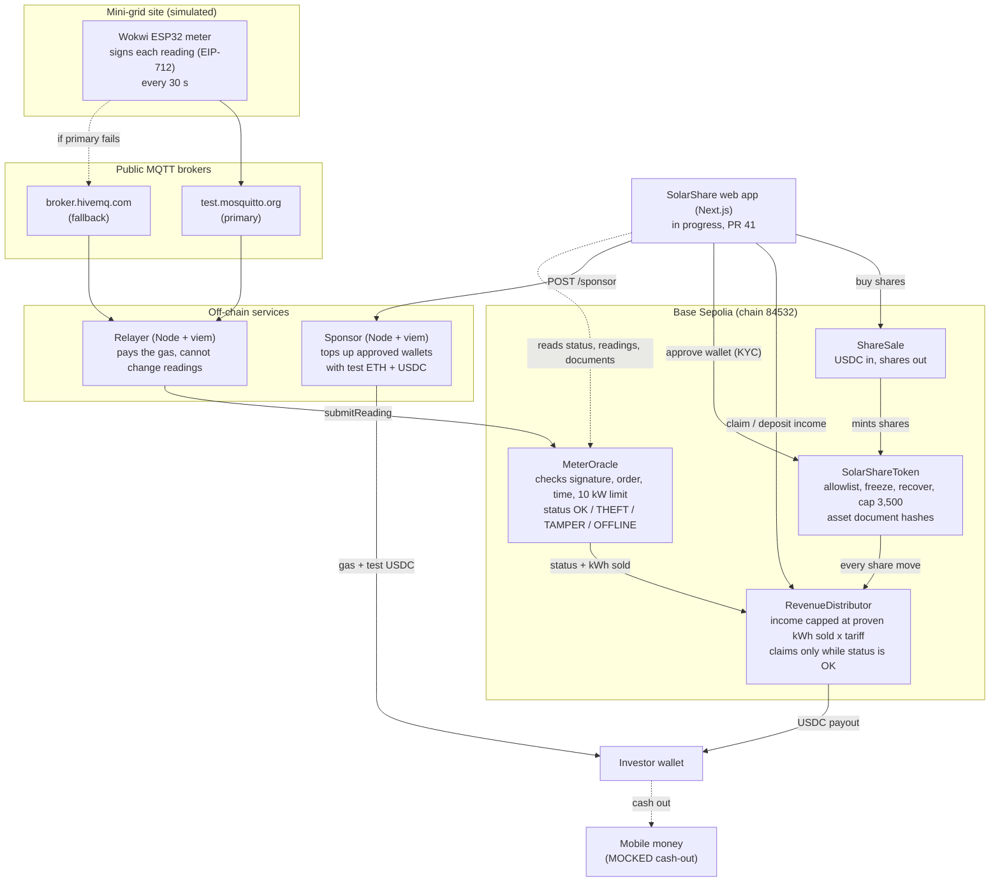

# SolarShare

[](https://github.com/ORANKIIEY/SolarShare/actions/workflows/ci.yml)

**You co-own a community solar mini-grid, and it pays you every month.**

Node Engine Hackathon 2026 · Real-World Assets track · Base Sepolia testnet (test money only)

> **Draft.** The contracts, the meter and the relayer are live on Base Sepolia. The web app is still being built ([PR #41](https://github.com/ORANKIIEY/SolarShare/pull/41)) and the demo video is still to come (#33). [Status](#status) shows exactly what works today. Every mock is labelled in [What is real and what is mocked](#what-is-real-and-what-is-mocked).

---

## In one minute

- **What you own.** Neighbours in a South African township buy shares in a 10 kWp solar mini-grid with a battery. There are 3,500 shares at 5 USDC each (about R83 a share).
- **How you get paid.** The mini-grid sells electricity to 20 homes and 5 spaza shops on prepaid meters. Each month, the income left after running costs is paid to shareholders in USDC, a digital dollar, which they can cash out to mobile money.
- **How you know the money is real.** A meter at the mini-grid counts the electricity produced and sold, signs every reading with its own secret key, and puts it on a public blockchain where anyone can check it. Income can only be paid in for energy the meter has signed for. If power is stolen, the meter is tampered with or it goes silent, **payouts pause automatically**, and everyone can see why.

**The problem.** Neighbours who co-own solar struggle to get a fair share of the income: nobody can easily check how much power was really produced and paid for, and illegal connections quietly drain the income before it reaches the owners. SolarShare pays out only for energy a tamper-checked meter has signed for onchain.

## Demo video

🎬 **Coming soon** (#33). The video will show the full demo below, start to finish.

## The money, in short

From the [money model](docs/money-model/README.md) (every number there is an assumption or a mock, and is labelled):

| | |
| --- | --- |
| Monthly sales | about 1,400 kWh × 0.20 USDC = **280 USDC** (R4,620) |
| Paid to investors after costs | **112.60 USDC a month** |
| Yearly yield | **about 7.7%** at 5 USDC a share (6.4% at 6 USDC) |
| Example investor | 20 shares (100 USDC) earn about 0.64 USDC (R10.62) a month |
| What theft costs | 20% of the power stolen cuts payouts by **almost half (−46%)** |
| How SolarShare earns | 3% of each site's sales, taken before income is deposited (not enforced onchain in the demo) |

The honest catch: 3,500 shares at 5 USDC raise R288,750, which is R61,250 short of the R350,000 system cost. The money model explains the two fixes.

---

## How it meets the four MVP requirements

| Requirement | What SolarShare does | Check it yourself |
| --- | --- | --- |
| **1. A token for one specific asset on a public testnet** | `SolarShareToken`: 3,500 shares in one mini-grid (Soweto Block A, a placeholder name), on Base Sepolia. Source code is published on Basescan. | [Token on Basescan](https://sepolia.basescan.org/address/0x025A0eA625e462A4906C9811dcde14075cBD8491) · [`SolarShareToken.sol`](Blockchain/contracts/SolarShareToken.sol) |
| **2. At least one rule enforced onchain** | Only approved (KYC'd) wallets can hold or buy shares. Frozen wallets can't move them. Supply can never pass 3,500. Payouts can only be claimed while the meter says OK. Income can't exceed what the meter proved was sold. | [Rules table](#rules-the-contracts-enforce) · [contract tests](Blockchain/test/) · a claim reverting with `MeterNotOk(THEFT)` in the [live meter proof](docs/live-meter-proof/README.md) |
| **3. Evidence of backing that judges can check** | **Signed meter readings:** the Wokwi meter's readings landed on Base Sepolia and MeterOracle checked every signature. **Document hashes:** three sample asset documents (SPV certificate, installation certificate, power purchase agreement) have their SHA-256 fingerprints stored in the token. | Readings: [THEFT flip](https://sepolia.basescan.org/tx/0x216c3a16f67aa5f46647aadf56de9490fdbd7cbd9ac9a288175ede8707177591) and [recovery](https://sepolia.basescan.org/tx/0xfa73da8ccc4b2952fdcf4e6f1df20f0a9d763c52be8a5d5b0a81accfcf641661), all 12 in [`docs/live-meter-proof/`](docs/live-meter-proof/README.md) · Documents: [`docs/asset-documents/`](docs/asset-documents/README.md), `getDocuments()` on the token |
| **4. A path back to cash** | Shareholders claim monthly payouts in USDC (Circle's test USDC) from `RevenueDistributor`. Cash-out to mobile money is **mocked**: a receipt screen, with a licensed partner such as Kotani Pay or Yellow Card in production. | [`RevenueDistributor.sol`](Blockchain/contracts/RevenueDistributor.sol) · [Distributor on Basescan](https://sepolia.basescan.org/address/0x3CB94fb9C7AaF42c959A414da750dE2DE761942b) · [money model, section 5](docs/money-model/README.md#5-example-investor-a-spaza-owner-buys-20-shares) |
| **Our extra: theft protection** | If sold energy falls more than 15% behind produced energy, the meter is tampered with, or it goes silent, the status leaves OK and claims pause until it recovers. | [Live meter proof](docs/live-meter-proof/README.md) |

---

## How it works



1. **The meter measures** the energy produced and the energy sold to customers ([`Hardware/wokwi-meter/`](Hardware/wokwi-meter/README.md)).
2. **The meter signs** each reading with its own key, the real time and a counter that only goes up, so readings can't be faked or replayed. The exact format is in [`MESSAGE_FORMAT.md`](Hardware/wokwi-meter/MESSAGE_FORMAT.md).
3. **The reading travels over MQTT** to the relayer, which listens on both brokers at once ([`Blockchain/relayer/`](Blockchain/relayer/README.md)). The relayer pays the transaction fee. It can't change a reading: one changed number breaks the signature.
4. **MeterOracle checks it.** The signature must come from the registered meter, the counter must go up, the totals can't go down and the power can't pass 10 kW. It then records the reading and sets the status.
5. **Money follows the proof.** The operator can only deposit income up to *meter-proven kWh sold × tariff*. Shareholders claim their share, but only while the status is OK.
6. **No gas for investors.** Once an investor's wallet is approved, the web app asks the sponsor service to send it a little test ETH (for fees) and test USDC, so buying never shows a gas prompt. This is a demo shortcut; production would use a smart wallet with a paymaster.

### Rules the contracts enforce

| Rule | When broken |
| --- | --- |
| Only approved wallets can hold or buy shares | Transfer or purchase reverts |
| Frozen wallets can't move shares; admin can recover them to a new wallet | Transfer reverts; recovery is logged |
| Total shares can never pass 3,500 | Mint reverts |
| Readings must be signed by the registered meter | Reading rejected |
| Each reading must be newer than the last, and totals can't go down | Reading rejected |
| Power can't pass the system's 10 kW rating | Reading rejected |
| Sold energy must stay within 15% of produced energy | Status THEFT, claims paused, recovers by itself |
| Tamper switch opened | Status TAMPER, claims paused until an admin clears it |
| No reading for 120 s (short, for the demo) | Status OFFLINE, claims paused until readings resume |
| Income deposited can't pass what the meter proved was sold | Deposit reverts |

Every mint, transfer, freeze, reading and payout emits an event that an auditor can replay.

---

## The demo: the judge plays the thief

1. Buy shares on a phone in under 2 minutes, with no wallet pop-ups or crypto jargon. *(web app, PR #41)*
2. Open the asset page. The meter is green, readings are arriving, and each one links to Basescan. *(web app, PR #41)*
3. The operator deposits the month's income and the investor claims a payout.
4. **Hand a judge the Wokwi meter and ask them to steal power.** Within a reading or two the status turns THEFT, a signed record appears on Basescan, and payouts pause.
5. Change one number in a reading before it reaches the chain. The signature no longer matches and it is rejected.
6. The judge turns the dial back. The status returns to OK by itself and payouts resume.

Steps 4 and 6 already ran live on Base Sepolia: see [`docs/live-meter-proof/`](docs/live-meter-proof/README.md). If Wokwi or the brokers are down, the relayer's software meter plays the same sequence ([Run it yourself, step 3](#3-the-relayer-meter-readings-to-the-chain)).

---

## What is real and what is mocked

In a hackathon we build the onchain, meter and app layers for real, and mock the physical, legal and banking layers. Each mock names the partner we would use.

| Part | In this demo | What it needs to be real |
| --- | --- | --- |
| **The site: "Soweto Block A"** | **Mock:** a placeholder name. The owner "Solar Share Block A SPV (Pty) Ltd" is fictional too. | A real named site and community (team task #31) |
| **The physical mini-grid** | **Mock:** a simulated ESP32 meter in Wokwi, with dials for sunlight and theft | A solar installer and a mini-grid operator; real meter hardware |
| **The SPV and its documents** | **Mock:** three SAMPLE PDFs, watermarked "not a real document", with their hashes stored onchain | A law firm to set up the SPV; FSCA advice (crypto assets are financial products under FAIS); NERSA or municipal registration of the generator |
| **Identity checks (KYC)** | **Mock:** an operator "approve" button (`approveWallet`) | A KYC provider, e.g. Smile ID |
| **Customers paying for power** | **Mock:** the operator deposits test USDC | A prepaid electricity vendor using South Africa's STS prepaid token standard |
| **Cash-out to mobile money** | **Mock:** a receipt screen in the web app | A licensed on/off-ramp partner, e.g. Kotani Pay or Yellow Card |
| **The meter's secret key** | **Mock:** a test key in the firmware's `secrets.h` | A secure element chip in the meter, e.g. ATECC608 |
| **USDC** | Circle's test USDC on Base Sepolia (no real value) | Real USDC on Base mainnet |
| **No gas for investors** | **Demo shortcut:** the sponsor sends test ETH to approved wallets | A smart wallet (ERC-4337) with a paymaster |
| **MQTT brokers** | Free public brokers, no login | A private broker with TLS |
| **The money model's numbers** | **Assumptions**, each labelled in the model | A real installer quote and user interviews (#30) |
| **SolarShare's 3% platform fee** | Off-chain, not enforced by the contracts | The same, or a fee step in the contracts |
| **Token, rules, signed readings, payouts, relayer** | **Real**, on Base Sepolia | Move to mainnet after an audit and the licences below |

---

## Status

| Part | Folder | Status |
| --- | --- | --- |
| Smart contracts (token, oracle, distributor, share sale) | [`Blockchain/contracts/`](Blockchain/contracts/) | ✅ Deployed and source verified on Base Sepolia |
| Meter firmware that signs readings | [`Hardware/wokwi-meter/`](Hardware/wokwi-meter/README.md) | ✅ Live: signed readings accepted onchain |
| Relayer (MQTT → Base Sepolia) | [`Blockchain/relayer/`](Blockchain/relayer/README.md) | ✅ Live |
| Sponsor (hides gas from investors) | [`Blockchain/relayer/src/sponsor/`](Blockchain/relayer/README.md#sponsor-hide-gas-from-investors-16) | ✅ Built and tested; runs on your laptop |
| Sample asset documents | [`docs/asset-documents/`](docs/asset-documents/README.md) | ✅ Hashes stored onchain |
| Money model | [`docs/money-model/`](docs/money-model/README.md) | ✅ Done |
| Investor and operator web pages | [`Frontend/`](Frontend/) | 🔨 In progress ([PR #41](https://github.com/ORANKIIEY/SolarShare/pull/41)) |
| Demo video | — | 🔜 To be recorded (#33) |
| Real named site and user interviews | — | 🔜 Team tasks (#30, #31) |

### Deployed contracts (Base Sepolia)

Chain id **84532** (Base Sepolia, a public test network: test money only). Click an address to see the contract and its source code on Basescan.

| Contract | Address |
| --- | --- |
| SolarShareToken | [`0x025A0eA625e462A4906C9811dcde14075cBD8491`](https://sepolia.basescan.org/address/0x025A0eA625e462A4906C9811dcde14075cBD8491) |
| MeterOracle | [`0x3e2e7f87610d978b922f5bD18624101d30D7c8B6`](https://sepolia.basescan.org/address/0x3e2e7f87610d978b922f5bD18624101d30D7c8B6) |
| RevenueDistributor | [`0x3CB94fb9C7AaF42c959A414da750dE2DE761942b`](https://sepolia.basescan.org/address/0x3CB94fb9C7AaF42c959A414da750dE2DE761942b) |
| ShareSale | [`0x652d15FEb0e57730b78A997c8decd46c81bf5cD2`](https://sepolia.basescan.org/address/0x652d15FEb0e57730b78A997c8decd46c81bf5cD2) |
| USDC (Circle test) | [`0x036CbD53842c5426634e7929541eC2318f3dCF7e`](https://sepolia.basescan.org/address/0x036CbD53842c5426634e7929541eC2318f3dCF7e) |

The meter's device address (the only key MeterOracle accepts readings from) is `0xaa69C29dA92fa7d0Ef717705Cd21Dd6e4D641ff3`. The full record (addresses, settings, transactions and ABIs) is in [`Blockchain/deployments/baseSepolia.json`](Blockchain/deployments/baseSepolia.json).

**Live meter proof (#5):** on 13 November 2026, 12 signed readings from the Wokwi meter reached MeterOracle through the relayer, with none rejected. Turning the theft dial switched the status to THEFT and paused payouts; turning it back restored OK by itself. The 12 readings cost about 0.0000045 test ETH in total. See [`docs/live-meter-proof/`](docs/live-meter-proof/README.md).

---

## Run it yourself

You need [Node.js](https://nodejs.org) 20 or 22 (LTS) and Git. Every command below runs from the folder named in its step. Nothing here needs real money.

```bash
git clone https://github.com/ORANKIIEY/SolarShare.git
cd SolarShare
```

**No setup at all?** Open the [live meter proof](docs/live-meter-proof/README.md) and click the transactions, or check a [sample document's hash](docs/asset-documents/README.md#how-the-hashes-prove-the-documents-werent-swapped) against the token's `getDocuments()`.

### 1. The contracts: build and test

```bash
cd Blockchain
npm install
npm run compile
npm test
```

`npm test` runs every contract and relayer test on a throwaway in-memory blockchain. No `.env` file or wallet needed. CI runs the same tests on every pull request.

### 2. A private blockchain on your laptop

Two terminals, both in `Blockchain/`.

```bash
npm run node
```

That starts a local blockchain. Leave it running. In the second terminal, make a test key for the software meter (this creates `relayer/.env` from [`relayer/.env.example`](Blockchain/relayer/.env.example) and prints the meter's address):

```bash
npm run relayer -- --new-demo-key
```

Deploy all four contracts with that address as the meter (a FAKE `MockUSDC` is used locally):

```bash
METER_DEVICE_ADDRESS=0xTheAddressFromAbove npm run deploy:local
```

On Windows PowerShell, set the variable first: `$env:METER_DEVICE_ADDRESS="0x…"; npm run deploy:local`.

### 3. The relayer: meter readings to the chain

The relayer's settings live in `Blockchain/relayer/.env` (git-ignored; the template is [`relayer/.env.example`](Blockchain/relayer/.env.example)). Run these from `Blockchain/`.

**Locally (after step 2):** play the scripted demo with the software meter: normal, theft, recovery, tamper and offline.

```bash
npm run relayer:demo -- --full --once
```

Watch the `STATUS OK -> THEFT` and `THEFT -> OK` lines. The relayer README explains [every log line](Blockchain/relayer/README.md#reading-the-log).

**On Base Sepolia (live, with the Wokwi meter):** in `relayer/.env`, set `NETWORK=baseSepolia` and `RELAYER_PRIVATE_KEY=` a testnet-only wallet holding a little Base Sepolia ETH ([faucets](Blockchain/README.md#get-test-money-issue-3)). Any wallet can relay: the oracle only trusts the meter's signature. The MeterOracle address is read from `deployments/baseSepolia.json`.

```bash
npm run relayer
```

**Demo backup on Base Sepolia (if Wokwi or the brokers are down):** the software meter signs readings with the meter's key, so `DEMO_DEVICE_PRIVATE_KEY` in `relayer/.env` must be the same test key as the Wokwi meter's.

```bash
npm run relayer:demo
```

Once the backup has run, stay on it for the rest of that demo: its totals are now ahead of what the Wokwi meter remembers ([why](Blockchain/relayer/README.md#demo-backup-the-software-meter)).

### 4. The Wokwi meter

Follow [`Hardware/wokwi-meter/README.md`](Hardware/wokwi-meter/README.md): paste `sketch.ino`, `diagram.json` and `libraries.txt` into a new ESP32 project on wokwi.com (no account needed), then add a `secrets.h` file based on [`secrets.example.h`](Hardware/wokwi-meter/secrets.example.h). For the deployed contracts it needs:

```c
#define DEVICE_PRIVATE_KEY_HEX "0x…the meter's test key…"
#define VERIFYING_CONTRACT "0x3e2e7f87610d978b922f5bD18624101d30D7c8B6"
```

The deployed MeterOracle only accepts the test key behind `0xaa69…1ff3`, which the team shares privately. With any other key, the meter still runs and signs, but the oracle rejects its readings. Don't click Save or Share in Wokwi while `secrets.h` is in the project.

To check the readings without a blockchain, run the laptop checker. It listens on both brokers and checks each signature:

```bash
cd Hardware/wokwi-meter/tools
npm install
npm run check -- --contract 0x3e2e7f87610d978b922f5bD18624101d30D7c8B6
```

Then start the relayer from step 3 to put the readings onchain, and turn the "illegal connection" knob to trigger THEFT.

### 5. The sponsor: no gas for investors

From `Blockchain/`:

```bash
npm run sponsor
```

It listens on `http://127.0.0.1:8787` (check `http://127.0.0.1:8787/health`). Locally it needs no key: the local node's first test account pays. On Base Sepolia, put a separate testnet-only wallet in `SPONSOR_PRIVATE_KEY` and fund it with test ETH and USDC. It only tops up wallets approved on `SolarShareToken`, with rate limits and a total budget. Details: [sponsor section](Blockchain/relayer/README.md#sponsor-hide-gas-from-investors-16); API: [`Blockchain/interface/README.md`](Blockchain/interface/README.md#sponsored-fees-16-hide-gas-from-investors).

### 6. The web app

Placeholder: the investor and operator pages are being built in [PR #41](https://github.com/ORANKIIEY/SolarShare/pull/41). See [`Frontend/README.md`](Frontend/README.md) for now. The final steps will be added here once #41 lands. Everything the app reads and writes is listed in [`Blockchain/interface/README.md`](Blockchain/interface/README.md).

### Deploying your own copy to Base Sepolia

You don't need this to try the demo. The team's deploy is already live. If you want your own copy, follow [Deploy in `Blockchain/README.md`](Blockchain/README.md#deploy) (`npm run preflight:baseSepolia`, then `npm run deploy:baseSepolia`).

---

## Risks, in plain language

**For investors**

- **Payouts can be smaller than planned, or stop for a while.** Theft, broken equipment, cloudy months or customers who don't pay all mean less income. Running costs stay the same, so every 1% of power stolen cuts payouts by about 2.3%.
- **It is a slow, steady income, not a quick profit.** About 7.7% a year in cash, but the equipment wears out, so a 20-share investor takes about 13 years to get their money back.
- **Selling your shares is hard.** Shares can only move to other approved wallets and there is no marketplace yet.
- **Currency.** Payouts are in USDC (a digital dollar) while costs are in rand, so the exchange rate moves the numbers.
- **Trust in the operator.** The contracts stop the operator paying out more than the meter proved was sold, but they can't force the operator to deposit the income. A real SPV, audits and reporting would cover that.
- **Pause, not prevent.** The meter makes theft visible within minutes and pauses claims, but it can't get stolen power back. Theft under the 15% line isn't flagged.

**For the technology**

- The contracts are tested but **not audited**. This is a testnet demo, with test money only.
- The meter key sits in firmware and the MQTT brokers are public. Neither can forge a reading (only the meter's signature counts), but production needs a secure chip and a private broker.
- Admin roles (KYC, freeze, recover, clear tamper) are held by one wallet in the demo. Production would use a multi-signature wallet.

**Licences and regulated partners needed** (more in [money model, section 6](docs/money-model/README.md#6-how-solarshare-makes-money-and-who-pays))

- **FSCA (FAIS Act):** crypto assets are financial products, so selling tokens needs a licensed crypto asset service provider, or a partner who holds a licence. A lawyer must check whether a public share offer needs a prospectus under the Companies Act.
- **FIC Act:** KYC and anti-money-laundering checks, e.g. with Smile ID.
- **NERSA and the municipality:** register the generator, get approval to connect, and confirm whether selling power to neighbours needs a licence or falls under an exemption.
- **Cash-out:** a licensed on/off-ramp such as Kotani Pay or Yellow Card.
- **Also:** an STS prepaid vendor, POPIA for customer data, and a tax adviser.

---

## Tech stack

| Layer | Technology |
| --- | --- |
| Blockchain | Solidity 0.8.28, OpenZeppelin Contracts v5, Hardhat, viem, Base Sepolia, Circle test USDC |
| Meter | ESP32 (Arduino C++), simulated in Wokwi, EIP-712 signing (secp256k1), MQTT |
| Relayer and sponsor | Node.js, TypeScript, viem, MQTT |
| Web app | Next.js, React, TypeScript, Tailwind CSS, viem |
| CI | GitHub Actions: contract tests and web app build on every pull request |

## Repository structure

```
SolarShare/
├── Blockchain/            # Smart contracts, tests, deploy scripts
│   ├── relayer/           # Relayer (meter → chain) and sponsor (gas for investors)
│   ├── interface/         # What the web app needs: ABIs, types, every read and write
│   └── deployments/       # Deployed addresses (baseSepolia.json)
├── Hardware/
│   ├── wokwi-meter/       # The SolarShare meter firmware and Wokwi circuit
│   └── wokwi-spike/       # The first signing test (issue #4)
├── Frontend/              # Next.js web app
├── docs/
│   ├── live-meter-proof/  # Signed readings on Base Sepolia, with links
│   ├── asset-documents/   # Sample PDFs and their hashes
│   └── money-model/       # The one-page money model
└── .github/workflows/     # CI
```

## Security

- Testnet only. Never use a wallet that holds real money.
- Private keys live in `Blockchain/.env`, `Blockchain/relayer/.env` and `Hardware/wokwi-meter/secrets.h`. All three are git-ignored. Never commit a key.
- The meter's signing key is stored in firmware for the demo only. A production meter would keep it in a secure chip.
